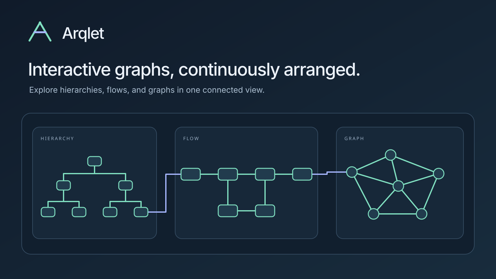

# Arqlet



**Interactive graphs, continuously arranged.**

Combine hierarchies, flows, and graphs in a single diagram.

Arqlet is an incremental graph-layout engine in Rust. It lays out nested graphs
with ports, routes their edges and keeps the layout up to date as the graph
changes. The same engine runs natively and in the browser via WebAssembly.

> **Status: prototype (engine `0.2.0-prototype`).** Arqlet works end to end and is
> tested, but every API, the JSON protocol and the snapshot format are
> provisional and may change in any release. Version 0.4.0 is on
> [crates.io](https://crates.io/crates/arqlet) and [npm](https://www.npmjs.com/package/arqlet). Large graphs (100K+ nodes) are a goal, not a measured result.

Arqlet was developed under the working name Layerweave. Measurement records in
`benchmarks/results` from before 2026-11-09 and some dataset names (such as
`layerweave-code`) keep that name.

## What works today

- **Graphs:** nested containers, ports, cycles, self-loops and parallel edges.
  Logical edge direction is preserved in every output.
- **Flexible layout:** hierarchical (layered) layout with a single pass by default;
  each container chooses its own direction, strategy (layered, tree, radial, organic)
  and routing style, all in one diagram.
- **Routing:** orthogonal and polyline routes, port sides and order, and bundled
  edges.
- **Incremental edits:** you can add a node, collapse or expand a container,
  change a direction or repair routing locally. Unaffected inner layouts are
  reused, and an optional background refinement improves the result.
- **Stale results:** every result carries a revision and is rejected if the
  graph has moved on, never applied silently.
- **Deterministic output:** identical for any thread count.
- **Three deployment modes over one dispatcher:**
  - split: the backend precomputes and the browser continues;
  - browser-only;
  - backend-only.
- **Inputs:**
  - Arqlet snapshots;
  - [Intentweave](https://github.com/intentweave) graph exports;
  - graphs in the JSON form [ELK](https://eclipse.dev/elk/) uses (`children`,
    `ports`, `edges`, `layoutOptions`). Options without a counterpart are
    reported as diagnostics.
- **Output:** a renderer-independent scene, an SVG viewer and a React Flow
  adapter.
- **Abstraction for large graphs (provisional):** groups found in the edges
  (communities) or given by the domain, collapsed at first and opened level by level;
  edges between groups drawn as one weighted route per pair.
- **Path cut-out (provisional):** the paths between two nodes highlighted, also through
  collapsed groups; only the groups on the way opened, the rest faded.
- **Cluster overview (prototype):** the whole graph as nested discs, laid out per
  container and drawn with WebGL, with a fisheye lens; a click switches a small cluster
  in place to a layered layout, and its neighbours make room
  ([ADR 0018](docs/adr/0018-cluster-overview.md), `apps/playground/overview.html`).

Not yet: full crossing minimization, guaranteed obstacle-free routes in every
case, a native Node.js adapter, and a stable API. See
[docs/specification.md](docs/specification.md) section 8 for the detailed status.

## Quick start: browser demo

Requires Rust with the `wasm32-unknown-unknown` target, Node 24+ and Python 3.

```sh
rustup target add wasm32-unknown-unknown
sh apps/playground/build.sh examples/fixtures/small.json
python3 apps/playground/server.py      # http://127.0.0.1:8765
```

`build.sh` builds the WASM engine and runs the demo's tests. Pass any other
`graph.json`, for example an Intentweave export. See the
[playground README](apps/playground/README.md).

## Using the engine

Every operation is a JSON request to one dispatcher, the same in Rust, in WASM and
behind the loopback backend. In Rust, add the `arqlet` crate (newer, unreleased work:
depend on the Git repository instead):

```toml
[dependencies]
arqlet = "0.4"
```

```rust
let request = r#"{"op": "elkLayout", "graph": {
  "id": "root",
  "children": [{"id": "a", "width": 40, "height": 30}, {"id": "b", "width": 40, "height": 30}],
  "edges": [{"id": "e1", "sources": ["a"], "targets": ["b"]},
            {"id": "e2", "sources": ["b"], "targets": ["a"]}]
}}"#;
let response = arqlet::dispatch(request);
// {"ok": true, "graph": {...with x, y and edge sections...}, "diagnostics": [...]}
```

The `layout-command` binary does the same on stdin:

```sh
cargo run --release -p arqlet-runtime --bin layout-command < request.json
```

In JavaScript, `npm install arqlet` (`packages/arqlet`) is the entry point. It ships the
WASM engine, which runs in browsers and in Node:

```js
import {loadEngine, createElkLayout} from 'arqlet';

const run = await loadEngine();
const laidOut = await createElkLayout(run).layout(graph);   // an elk.layout(graph)-style call
```

`createEngineWorker()` runs the engine in a worker; `renderSvg` and `toReactFlow` draw
or map a scene.

### Integrating: one-shot layout or a session

- **One-shot, ELK-compatible:** `createElkLayout(run).layout(graph)` takes a graph in
  ELK's JSON form and returns it laid out. Every call lays out from scratch, like ELK.
  `refine: true` only helps where the first layout has conflicts (routes through nodes,
  shared lines); on a clean drawing it returns the same drawing, a little later.
- **A session that keeps positions** (drill-down, edits): `createSession(run)` keeps the
  current snapshot and sends changes as operations on it. Unchanged parts are reused,
  changes run in order, and an answer overtaken by a new import is reported as stale
  instead of applied:

  ```js
  import {loadEngine, createSession} from 'arqlet';

  const session = createSession(await loadEngine());
  await session.import(graph);           // nodes with parentId are containers
  await session.collapse('group-1');     // or expand, toggle, apply({op: 'direction', …})
  draw(await session.scene());
  ```

  In a browser, `createSession(workerRun(createEngineWorker()))` runs the same in a
  worker, and `createSession(httpRun('/api'))` in a backend (the playground's
  `server.py`, or any host that runs `layout-command --sessions`). The snapshot stays inside the engine (or its worker): a change sends only
  itself and gets back the scene, so reading and drawing large views stays cheap
  ([measurement](benchmarks/results/protocol-resident-20261112.md)).
  `session.snapshot` holds the view's state; `await session.exportSnapshot()` gives the
  whole snapshot, to save or to hand to another engine.
- **Large graphs:** `{op: 'overview', graph}` and the WebGL renderer (see the
  [package README](packages/arqlet/README.md)).

## Large graphs: abstraction, paths and the overview

All of this is provisional and off by default; the default layout does not change. The
examples use the JavaScript session; the same requests go to `arqlet::dispatch` in Rust.

### Flexible layout per container

A graph says per container how it is laid out, and a session can change it later:

```js
await session.import({
  nodes, edges,                                   // nodes with parentId are containers
  defaultDirection: 'lr',
  containerDirections: {'service-a': 'tb'},       // lr, rl, tb, bt, or auto
  containerStrategies: {'org': 'tree', 'deps': 'organic'},   // layered, tree, radial, organic
  containerRouting: {'deps': 'straight'},         // orthogonal, polyline, straight, …
});
await session.apply({op: 'direction', nodeId: 'service-a', direction: 'lr'});
await session.apply({op: 'strategy', nodeId: 'org', strategy: 'radial'});
```

### Groups and drill-down

Large containers and flat graphs are divided into groups that start collapsed; a
collapsed group is one box, and the edges it exchanges with another group are one route
that carries their number in both directions (`weight`, `backWeight` in the scene). An
input edge that already stands for several (a pre-aggregated relation) says how many with
`weight` (`{id, kind, source, target, weight: 12}`); it counts as many in these routes, in
bundles, in the filter's recount and in the overview's pull, and does not move anything.

```js
await session.import(graph, {options: {
  communities: 40,                       // divide containers of more than 40 children (Louvain)
  communityHubs: {minLinks: 50},         // but leave hubs out: they stay as themselves
  groups: {'fn-1': ['Billing', 'Invoices']}, // or groups the domain gives: a path of names per node
  levelOfDetail: {depth: 1},             // and/or collapse containers from a depth or by kind
}});
await session.toggle('group:#:Billing'); // open a group in place; the others keep their place
```

Given groups come first; Louvain only divides what is still large. Groups exist only in
the view: the source graph is never changed. In the playground: *Communities above*,
*Domain groups*, *Level of detail*, and the example *Flat call graph*.

The same words apply to both views (the session's layered view and the cluster overview):
`groups`, `communities` divide what is large; `levelOfDetail: {depth, kinds}` says what is
collapsed at first, and the user opens it (`toggle`, `reveal`, a double-click in the
overview).

### Path cut-out

`trace` finds the nodes and edges on the shortest (or all) directed paths between two
nodes, also inside collapsed groups, and tells which boxes and routes of the current
view carry them and how far every other node is. `reveal` opens only the groups on the
way: the other children of an opened group wait in a collapsed `+N more` box. With
`edgeKinds` the paths follow only edges of those kinds (the data flow, say, not the calls).
`neighbourhood` answers the same way for the nodes within some hops of a node.

```js
const path = await session.trace('a', 'z');                 // read only; {mode: 'all'} for every path
const flow = await session.trace('a', 'z', {edgeKinds: ['imports']});   // along these edge kinds only
const near = await session.neighbourhood('a', {hops: 2, direction: 'out'}); // what a leads to, two hops; 'in', 'both'
await session.reveal(near.nodes);
renderSvg(svg, await session.scene(), {trace: {...path.visible, distance: path.distance, fade: true}});
await session.reveal(path.nodes);                            // only as far as needed; {partial: false} opens whole
```

In the playground: section *Path* (from, to, *Trace*, *Reveal path*, *Fade others*,
*Show a node*).

### Filter

`filter` hides nodes by kind or id (each with what it holds) and edges by kind, without
a new import: what stays keeps its place, and a route that stands for collapsed content
counts only the edges still shown. With `compact: true` the view is laid out again
without what is hidden, so the rest closes up (positions change). The next filter
replaces it; `{}` shows everything.

```js
await session.filter({nodeKinds: ['test'], edgeKinds: ['imports']});
await session.filter({nodes: ['vendor']});                   // a container with all it holds
await session.filter({nodes: ['vendor'], compact: true});    // and close up the gap
await session.filter({});                                    // everything again
```

In the playground: section *Filter* (a box per node kind and edge kind, *Close up*).

### Graph changes

`patch` changes the graph of a view without a new import: `{nodes, edges, removeNodes,
removeEdges}` (removals first; a removed node takes what it holds and its edges). The
view keeps its state (collapsed containers, filter) and is laid out again from where it
was, so a host can start with aggregated edges between collapsed containers and load the
member edges of a container when it is opened:

```js
await session.expand('billing');
await session.patch({edges: memberEdgesOf('billing'), removeEdges: aggregatedEdgesOf('billing')});
```

### Cluster overview

For a whole graph of tens of thousands of nodes, `{op: 'overview', graph}` lays it out
as nested discs and the WebGL renderer draws it; a cluster can switch in place to its
layered layout. A fisheye lens follows the pointer (enlarging what is under it and its
labels, picking through it), and the discs can breathe while nobody touches the view:

```js
bindOverviewNavigation(canvas, renderer, {
  lens: () => ({radius: 180, magnification: 3}),
  idle: {after: 8000, breathe: {amplitude: 0.06}},   // off under reduced motion
});
```

For hierarchical exports the overview can gather and fold what adds little (all off by
default): `satellites` gathers a node with the siblings that send most of their edges to it
(`<hub> +<n>`), `chains` draws a chain of single children (a package with one module
with one file) as one disc, and `groups` takes the domain's groups as for an import. Added
clusters are named after their most connected member (`≈ <name>`). A config set's
`overview.levelOfDetail` collapses from a depth or by kind, and the renderer draws a kind
as a circle, square, octagon or diamond:

```js
const {overview} = await run({op: 'overview', graph, options: {satellites: 0.6, chains: true},
  configSet: {...base, overview: {levelOfDetail: {depth: 0}}}});
const renderer = createOverviewRenderer(canvas, overviewModel(overview), {shapes: {service: 'square', package: 'octagon'}});
```

See the [package README](packages/arqlet/README.md) and `apps/playground/overview.html`.

The engine computes the same on every platform: native builds (Linux x64 and arm64,
macOS arm64, Windows x64) and WASM give identical responses (checked in CI by
`tools/platform-parity.mjs`), so a backend and a browser can continue each other's work.

## Repository structure

| Path | Contents |
|---|---|
| `crates/model` | canonical graph, identities, layout options |
| `crates/view` | visible and aggregated projection |
| `crates/layout` | layering, ordering, placement, ports, constraints |
| `crates/routing` | edge routes and bundles |
| `crates/scene` | renderer-independent geometry and metrics |
| `crates/topology` | planarity embedding and straight-line grid drawings |
| `crates/runtime` | dispatcher, snapshots, patches, incremental scheduling; `snapshot` and `layout-command` binaries |
| `crates/elk` | adapter for graphs in ELK's JSON form |
| `crates/reference` | curated reference diagrams (canonical JSON, validation, SVG) |
| `crates/wasm` | browser ABI (`lw_alloc`, `lw_free`, `lw_run` with JSON payloads) |
| `crates/contracts` | generates the TypeScript contract types (tooling) |
| `crates/node` | placeholder for a native Node.js adapter |
| `crates/arqlet` | facade crate: re-exports the engine crates and `dispatch` |
| `packages/arqlet` | npm entry point: re-exports engine client and viewer |
| `packages/engine-client` | the WASM engine with loader, worker protocol, presets, ELK-style API |
| `packages/viewer` | SVG rendering, navigation, React Flow adapter |
| `packages/containment-tree` | interactive containment tree of a scene |
| `packages/contracts` | generated TypeScript types for snapshot, scene and config sets |
| `apps/playground` | demo UI, comparison view and loopback backend |
| `examples/react-flow` | React Flow example |
| `tools/intentweave-export` | standalone exporter for Intentweave graphs (Node 24+) |
| `benchmarks/` | datasets, measurement scripts, recorded results, external-engine evaluation |

The core crates are synchronous, pure and deterministic. They have no browser,
Node, file system or network dependencies; only `serde` and `serde_json`.

## Documentation

- [Specification and implementation status](docs/specification.md)
- [Architecture](docs/architecture.md) and [decisions (ADRs)](docs/adr/)
- [Roadmap](docs/roadmap.md)
- [Configuration](docs/configuration.md) and [config sets](docs/config-sets.md)
- [Scene and viewers](docs/scene-viewers.md)
- [Comparison with other engines](docs/comparison.md) (dagre, elkjs, elk-rs)
- [Benchmarks](benchmarks/README.md)
- [Releasing to crates.io and npm](docs/releasing.md)

Performance figures are only stated with a results file in `benchmarks/results/`
that records machine, build and revision.

## Development

```sh
cargo fmt --all -- --check
cargo check --workspace --locked
cargo test --workspace --locked
sh apps/playground/build.sh examples/fixtures/small.json   # WASM, demo and browser tests
```

For faster local test runs use `cargo test --workspace --profile fast`. The
Intentweave exporter has its own tests: `cd tools/intentweave-export && npm test`.

## Contributing

Contributions are welcome. See [CONTRIBUTING.md](CONTRIBUTING.md): every commit needs a
Developer Certificate of Origin sign-off (`git commit -s`).

## Third-party code

No implementation code from other layout engines has been copied. External
engines (elkjs, elk-rs, dagre) are used only for evaluation in `benchmarks/eval`
and keep their own licenses. ELK and Eclipse are trademarks of the Eclipse
Foundation; Arqlet is not affiliated with it.

## License

Copyright 2026 Benjamin Becker.

Licensed under either of

- Apache License, Version 2.0 ([LICENSE-APACHE](LICENSE-APACHE))
- MIT license ([LICENSE-MIT](LICENSE-MIT))

at your option.

Unless you explicitly state otherwise, any contribution intentionally submitted
for inclusion in the work by you, as defined in the Apache-2.0 license, shall be
dual licensed as above, without any additional terms or conditions.
